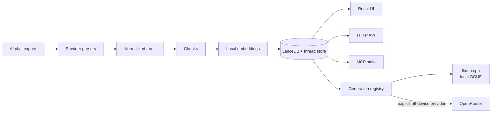

# ThreadShelf

> **這是翻譯。** 本文件是上游英文 README 的繁體中文（臺灣）譯文，不是另外撰寫的說明。程式碼區塊、指令、環境變數、路徑與連結都維持原文。譯文若與原文不一致，以英文為準。
>
> 英文原文：
>
> - 本儲存庫的 [README.en.md](README.en.md)（與下面這份上游版本內容相同）
> - 翻譯所根據的上游版本：[ChrystianSchutz/ThreadShelf 的 `README.md`](https://github.com/ChrystianSchutz/ThreadShelf/blob/f13b721561305c3b040dc701ce86553ec36c4447/README.md)
> - 上游預設分支上的最新版：[README.md](https://github.com/ChrystianSchutz/ThreadShelf/blob/main/README.md)

**把你的 AI 對話留在本機：封存、語意搜尋，以及接續。**

[](https://github.com/ChrystianSchutz/ThreadShelf/actions/workflows/ci.yml)
[](package.json)
[](LICENSE)
[](#privacy-boundary)

**ChatGPT、Claude、Google AI Studio、OpenRouter、LM Studio 與 Grok** 可以放在同一個私人工作區。依語意找回舊對話、重新打開完整對話串，再用本機 GGUF 模型透過 `llama.cpp` 接下去；也可以改用明確標為外部服務的 OpenRouter。

整條封存流程（解析、嵌入、LanceDB 儲存、搜尋、HTTP API 與 MCP）都在本機跑。對話生成是選用的：`llama.cpp` 只聽本機迴送；若改選有清楚標示的 **OpenRouter · 外部** 供應商，被選到的使用者／助理上下文與新的提示會送出裝置外。


| 能力 | ThreadShelf 提供什麼 |
| --- | --- |
| **封存與檢索** | 多個來源的正規化、本機多語嵌入、語意搜尋與精確搜尋、完整對話串重建 |
| **接續與新對話** | 透過受管理的 `llama.cpp` 做本機 GGUF 推論，以及選用的 OpenRouter 串流 |
| **哪裡都能用** | 同一份索引上的 React UI、命令列索引／搜尋、HTTP API，以及 MCP stdio 伺服器 |
| **資料由你掌控** | 預設只聽本機迴送、獨立的本機儲存、送出裝置外時有明確標示、測試資料都是合成的 |

---

**說明文件：** [chrystianschutz.github.io/ThreadShelf](https://chrystianschutz.github.io/ThreadShelf/)

> **官方來源。** ThreadShelf 只以這個 GitHub 儲存庫，以及 npm 套件 [`threadshelf`](https://www.npmjs.com/package/threadshelf)（`npx threadshelf`）發布。沒有安裝程式，也沒有 `.exe` 或 `.zip` 可下載。若你找到這類檔案，那不是這個專案提供的，請回報。

## 30 秒看懂它做什麼

1. 把聊天紀錄匯出或複製成 JSON（見[取得你的資料](#get-your-data)）。
2. ThreadShelf 把它們解析成共通格式，在**本機**做嵌入，再存進本機向量資料庫（LanceDB）。
3. 在網頁介面依語意搜尋、打開原始的完整對話串，並把任一段對話匯出成 Markdown；也可以從 MCP 用戶端查同一份索引。
4. 需要的話，可以用本機 `llama.cpp` 或明確標為外部的 OpenRouter，開一段新對話，或接續已封存的對話串。

## 架構一覽

下圖的節點文字維持英文原文。



## 和其他對話歷史工具有什麼不同？

- **六個來源，一份正規化之後的封存。** 這些來源的歷史原本散落在匯出檔、雲端硬碟、瀏覽器頁面與本機應用程式資料裡。
- **除了關鍵字，還有語意。** 就算想不起確切用詞，也能依主題找回對話；真的記得原文時，可以改用精確比對（錯誤字串、識別碼、程式碼）。
- **本機封存，生成只是加上去的一層。** 就算沒有設定任何 LLM，搜尋一樣能用。要生成時，主要引擎是僅限本機迴送的 `llama.cpp` 伺服器；OpenRouter 是另外標示的外部選項。
- **一份索引，三種使用方式。** 網頁介面、HTTP API，以及任何支援 MCP 的工具，查的都是同一份封存。

## 和其他工具的比較

ThreadShelf 把本機對話封存、語意搜尋，以及選用的對話接續放在一起。下表的工具和這個流程有重疊，但也涵蓋別的需求，包括文件研究與代理編排。

這是 **2026-10-03** 看過的文件快照，依據表中連結的上游來源（LibreChat 的文件標為 **Latest / dev**）。實際安裝的版本、設定與擴充功能可能不同。

| 專案 | 主要用途 | 文件所載的搜尋與來源範圍 | 工作流程與整合 |
| --- | --- | --- | --- |
| **ThreadShelf** | 在本機封存、尋找並接續 AI 對話 | 針對 ChatGPT、Claude、AI Studio、OpenRouter、LM Studio 與 Grok 的匯出，提供本機多語語意搜尋與精確子字串搜尋 | 同一份索引上的 Web UI、CLI、HTTP API，以及 MCP **伺服器**；可選由 ThreadShelf 管理的 `llama.cpp`，或明確標為外部的 OpenRouter 來接續 |
| [LibreChat](https://github.com/LibreChat-AI/LibreChat) | 多供應商聊天與代理 | [對話歷史的關鍵字搜尋](https://www.librechat.ai/docs/features/search)；針對上傳檔案的語意檢索。[匯入](https://www.librechat.ai/docs/features/import_convos)支援 ChatGPT、Claude 與 ChatbotUI v1 | [代理](https://www.librechat.ai/docs/features/agents)、MCP 工具、分支與 artifacts；[使用者記憶](https://www.librechat.ai/docs/features/memory)把結構化條目和歷史搜尋分開存放 |
| [Open WebUI](https://docs.openwebui.com/features/) | 自架的聊天、知識與工具 | [ChatGPT 與原生聊天匯入](https://docs.openwebui.com/features/chat-conversations/data-controls/import-export/)；[文件 RAG](https://docs.openwebui.com/features/chat-conversations/rag/) | 本機或外部模型連線、記憶，以及可擴充的工具 |
| [AnythingLLM](https://github.com/Mintplex-Labs/anything-llm) | 私人的文件工作區與代理 | [針對工作區文件的檢索](https://docs.anythingllm.com/chatting-with-documents/introduction)，可設定片段挑選與重新排序 | 桌面或自架應用程式；本機或外部模型、[代理流程](https://docs.anythingllm.com/agent-flows/overview)與 [MCP 工具](https://docs.anythingllm.com/mcp-compatibility/overview) |
| [MyChatArchive](https://github.com/1ch1n/mychatarchive) | 給 AI 用戶端用的本機對話封存 | 本機語意與關鍵字搜尋；可匯入 ChatGPT、Claude、Grok、Claude Code 與 Cursor；選用的摘要會用到外部 LLM | CLI 與 MCP 伺服器、對話串群組、敏感等級，以及主題脈絡包 |
| [hstry](https://github.com/byteowlz/hstry) | 把寫程式的代理與網頁聊天的歷史收在一起 | 針對匯入的代理工作階段與網頁聊天歷史做全文搜尋 | CLI、TUI、MCP 與 API 元件；來源探索、瀏覽器同步，以及跨代理的工作階段接續 |
| [Polylogue](https://github.com/Sinity/polylogue) | AI 工作的證據與稽核軌跡 | 搜尋匯入的對話與寫程式的工作階段；來源裡有的話，會保留結構化的工具結果、譜系、用量與成本 | 本機封存、CLI、Python API、HTTP 讀取端與 MCP 伺服器 |
| [Open Notebook](https://github.com/lfnovo/open-notebook) | 圍繞來源與筆記的研究筆記本 | 針對研究內容的全文與向量搜尋；回答會附上來源引用 | 本機或外部模型設定、來源轉換、筆記與 REST API |

### ThreadShelf 的定位

| 你想做的事 | ThreadShelf 目前的做法 |
| --- | --- |
| 想不起用詞，但要找回舊討論 | 在封存裡依語意搜尋，再打開相符回合前後的完整對話串 |
| 要定位某一個錯誤、識別碼或程式片段 | 用關鍵字模式，並加上集合、角色、模型與日期篩選 |
| 用另一個模型接續已匯出的對話 | 重新打開已儲存的回合，再接上本機 `llama.cpp` 或明確標為外部的 OpenRouter |
| 讓現有的 AI 用戶端取回過去的對話 | 連到 MCP 伺服器的 `search` 與 `read_thread`，查的是同一份本機索引 |

若你要的是內建的代理編排、文件 RAG 或研究筆記本，上面對應的工具有更寬的流程。ThreadShelf 目前專注在找回對話、接續對話，以及範圍受限的 Obsidian 工具流程。一般的流程自動化、自動記住事實，以及附上封存引用的生成回答，都還是以後的方向。MCP 用戶端現在就可以用搜尋與讀取對話串的工具把上下文找回來；若那個用戶端用的是外部模型，這段上下文可能會送出裝置外。

暫時對話現在就有：在 **新對話** 旁邊點幽靈圖示，就會開始一段 **私人對話**。內容只留在這個分頁瀏覽器的 `sessionStorage`；不會存進封存、不會建立索引，生成診斷也不會留下來。就算選了 OpenRouter，這段對話仍會送出裝置外。見[對話生成](docs/GENERATION.md)。

### Markdown 筆記：Obsidian、Logseq、OpenClaw 與其他個人知識管理資料夾

在側邊欄打開 **Markdown/Obsidian**，接上任何一個 Markdown 筆記資料夾：Obsidian 的 vault（筆記庫）、Logseq 的 graph（圖譜）、OpenClaw 工作區，或一般的 `.md` 資料夾。電腦上找得到的 Obsidian vault 與 OpenClaw 工作區可以一鍵接上。在本機搜尋筆記、用 Obsidian 打開原檔，也可以在這個頁面建立新筆記。在對話裡啟用 **筆記工具** 之後，選中的模型就能在受限制的工具呼叫流程裡搜尋、讀取、建立與編輯筆記。

| 方向 | 可用的流程 |
| --- | --- |
| **Obsidian → ThreadShelf / AI** | 透過介面、HTTP API 與 MCP 即時做關鍵字搜尋與筆記閱讀，並附上相對來源路徑與原始 Markdown |
| **ThreadShelf → Obsidian** | 建立 Markdown 筆記，或請代理寫出帶來源連結的對話摘要；編輯既有筆記時會先核對版本 |

**允許寫入 vault** 預設是**關閉**的：接上的 vault 是唯讀，MCP 用戶端也一樣，直到你在 Markdown/Obsidian 頁面，或在輸入區旁邊開啟寫入。換接另一個 vault 會再次把寫入關掉。刪除一律先暫停對話，用核取方塊與確認畫面標出模型和確切檔案，等你明確同意。核准的刪除會把筆記移到 vault 的 `.trash`；取消則原樣保留。MCP 提供搜尋、讀取、建立、編輯；刪除只能在互動式聊天介面進行。

能存取的只有所設定 vault 裡的一般 `.md` 檔。隱藏資料夾、附件、符號連結、junction 與路徑穿越都排除在外。建立時絕不會覆寫既有筆記。搜尋讀的是檔案現況，不會重新匯入；筆記的語意索引與自動專案匯出仍是以後的工作。

用本機 llama.cpp 時，筆記上下文留在裝置上。OpenRouter 與外部 MCP 模型可能把檢索到的筆記內容送出裝置外。私人對話仍然可以寫入你明確開啟的 vault。工具、控制方式、API 路由與限制見 [Obsidian 整合](docs/OBSIDIAN.md)。

## 支援的來源

| 來源 | 怎麼匯出 | 格式穩不穩定 |
| --- | --- | --- |
| **Google AI Studio** | 下載雲端硬碟裡的「Google AI Studio」資料夾 | ⚠️ 沒有公開說明，2026 年 7 月測試過 |
| **OpenRouter** | 瀏覽器主控台匯出腳本（本儲存庫） | ⚠️ 沒有公開說明 |
| **LM Studio** | 複製本機的對話檔 | ⚠️ 沒有公開說明，在 **0.4.x** 測試過 |
| **Grok / xAI** | 帳號資料匯出（`prod-grok-backend.json`） | ⚠️ 沒有公開說明 |
| **ChatGPT / OpenAI** | 官方資料匯出（`conversations.json`） | 大致穩定 |
| **Claude / Anthropic** | 官方資料匯出 | 大致穩定 |

> ⚠️ **格式說明。** Google AI Studio、OpenRouter、LM Studio 與 Grok 都沒有公開、穩定的匯出結構，廠商可能不預告就改掉。ThreadShelf 是拿特定版本的快照在測（例如 LM Studio 0.4.x）。若較新的應用程式改了形狀，解析可能會壞；請附一份匿名化樣本來開 issue。

---

<a id="get-your-data"></a>

## 取得你的資料

你只需要處理自己真正有在用的來源。匯出檔放哪裡都可以，再把 ThreadShelf 指到那個資料夾。

### Google AI Studio

你的提示存在 **Google 雲端硬碟**，資料夾名稱是 **`Google AI Studio`**。

1. 打開 [Google 雲端硬碟](https://drive.google.com)，找到 `Google AI Studio` 資料夾。
2. 按右鍵 → **下載**（雲端硬碟會把它壓成 zip）。解壓縮到本機某處。
3. 索引那個資料夾。（檔案沒有 `.json` 副檔名也沒關係，ThreadShelf 看內容就能認出來。）

2026 年 7 月那版雲端硬碟匯出裡的文字對話，以及 Imagen 的提示歷史，都支援。這個格式沒有公開說明，以後可能改變。

### OpenRouter

OpenRouter 沒有批次匯出，所以這個儲存庫附了兩支瀏覽器主控台腳本：

- **全部對話：** [`scripts/openrouter-export-all.js`](scripts/openrouter-export-all.js) — 走訪側邊欄裡的每一段對話，每段下載一份 JSON。
- **單段對話：** [`scripts/openrouter-export-browser.js`](scripts/openrouter-export-browser.js) — 只匯出目前打開的那段。

要全部匯出的話：

1. 登入後打開 [openrouter.ai](https://openrouter.ai/)，讓對話列表（側邊欄）看得到。
2. 打開開發者工具 → 主控台（`F12` → _Console_ 分頁）。
3. 複製 `scripts/openrouter-export-all.js` 的全部內容，貼到主控台，按 Enter。
4. 腳本會點開每段對話、捲動以載入完整歷史，並為每段下載一份 JSON。若瀏覽器詢問，請允許「**下載多個檔案**」（multiple downloads）。
5. 把下載的檔案放進一個資料夾，再索引那個資料夾。

> 這些選擇器鎖在 OpenRouter 目前的聊天介面，並由 `test/playwright/openrouter-export.spec.js` 覆蓋。若 OpenRouter 改了頁面結構、腳本一個對話都找不到，要更新的約定就在那個測試裡。

你會得到一份長得像這樣的檔案（解析器讀的就是這個）：

```json
{
  "platform": "openrouter",
  "exportedAt": "2026-05-24T12:00:00.000Z",
  "pageTitle": "OpenRouter chat title",
  "sourceUrl": "https://openrouter.ai/chat/...",
  "turns": [
    { "role": "user", "content": "User message text" },
    { "role": "assistant", "content": "Assistant reply", "model": "optional/model-name" }
  ]
}
```

建立索引前，先確認下載內容：

```bash
npm run parse -- path/to/openrouter-export.json
```

細節與限制見 [docs/OPENROUTER.md](docs/OPENROUTER.md)。

### LM Studio

LM Studio 在本機**每個對話存一份 JSON**，不必另外匯出，只要把 ThreadShelf 指到那個資料夾（路徑如下）：

| 作業系統 | 路徑 |
| --- | --- |
| Windows | `%USERPROFILE%\.lmstudio\conversations\` |
| macOS / Linux | `~/.lmstudio/conversations/` |
| 較舊的版本 | `~/.cache/lm-studio/conversations/`（這裡也看一下） |

把路徑直接貼進 **手動資料夾路徑** 再索引，或先複製到別處：

```bash
# macOS / Linux
cp -r ~/.lmstudio/conversations ~/lmstudio-export

# Windows (PowerShell)
Copy-Item "$env:USERPROFILE\.lmstudio\conversations" "$env:USERPROFILE\lmstudio-export" -Recurse
```

檔名是 `<id>.conversation.json`，內容像這樣（這裡有截短。解析器讀的是 `messages[].versions[currentlySelected]`，並把 `thinking` 步驟和回答拆開）：

```json
{
  "name": "My chat",
  "createdAt": 1700000000000,
  "lastUsedModel": { "identifier": "gpt-oss-20b" },
  "messages": [
    {
      "versions": [
        { "type": "singleStep", "role": "user", "content": [{ "type": "text", "text": "Hi" }] }
      ],
      "currentlySelected": 0
    },
    {
      "versions": [
        {
          "type": "multiStep",
          "role": "assistant",
          "steps": [
            {
              "type": "contentBlock",
              "style": { "type": "thinking" },
              "content": [{ "type": "text", "text": "reasoning…" }]
            },
            { "type": "contentBlock", "content": [{ "type": "text", "text": "Hello!" }] }
          ]
        }
      ],
      "currentlySelected": 0
    }
  ]
}
```

對話資料夾與子資料夾會被遞迴走完。_在 LM Studio 0.4.x（0.4.16）測試過；格式沒有公開說明，可能改變。_

> **注意 — LM Studio 的本機伺服器（「router」）。** LM Studio 也可以跑一個相容 OpenAI 的本機伺服器（Developer 分頁，預設 `http://localhost:1234`），把請求分送到已載入的模型。那是**推論**端點，不是匯出。ThreadShelf 索引的是上面那些在磁碟上的 `conversations/` 檔，所以匯入或搜尋歷史時，不必把這個伺服器開著。

### ChatGPT / OpenAI

ChatGPT → **Settings → Data controls → Export data**。你會收到一封附有 zip 的電子郵件；請索引裡面的 `conversations.json`。

### Claude / Anthropic

Claude → **Settings → export your data**。索引匯出的對話 JSON。

### Grok / xAI

Grok → 申請你的 **帳號資料匯出**（xAI 的帳號／隱私設定）。下載內容裡，在某個 `export_data/.../` 資料夾底下會有 `prod-grok-backend.json`。索引含有該檔的那個資料夾即可。ThreadShelf 靠內容認出檔案，外層目錄叫什麼都沒關係。

整份檔案把所有對話放在同一個文件裡，形狀大致如下（解析器讀 `conversations[].responses[].response`，並把模型的 `agent_thinking_traces` 推理與 `message` 回答拆開）：

```json
{
  "conversations": [
    {
      "conversation": {
        "id": "…",
        "title": "My chat",
        "create_time": { "$date": { "$numberLong": "1771000000000" } }
      },
      "responses": [
        {
          "response": {
            "sender": "human",
            "message": "Hi",
            "create_time": { "$date": { "$numberLong": "1771000000000" } }
          }
        },
        {
          "response": {
            "sender": "assistant",
            "message": "Hello!",
            "model": "grok-3",
            "agent_thinking_traces": [{ "thinking_trace": "reasoning…" }]
          }
        }
      ]
    }
  ]
}
```

_時間戳記是 MongoDB 延伸 JSON（`{ "$date": { "$numberLong": … } }`）。格式沒有公開說明，可能改變。_

---

<a id="quick-start"></a>

## 快速開始

需要 **Node.js 20.19+** 與 npm。

```bash
npx threadshelf        # downloads, starts, opens on http://localhost:3000
```

這樣就安裝好了。套件裡已經帶了建置好的網頁介面，不必編譯，也不必 clone 儲存庫。要換連接埠就用 `npx threadshelf 3001`。其餘說明見 `npx threadshelf --help`。

終端機工具也一併附上：

```bash
npx threadshelf search "what did I decide about caching?"
npx threadshelf ingest ./my-exports my-collection
npx threadshelf parse ./chatgpt-export.json
npx threadshelf-mcp                      # stdio MCP server
```

封存**絕不會**放在 npm 套件裡面：`npx` 的安裝目錄是暫時的，npm 隨時可能把它清掉。持久資料改放在每個使用者自己的目錄，因此升級或清掉 npm 快取都不會動到你的索引。

| 平台 | 預設資料目錄 |
| --- | --- |
| Windows | `%LOCALAPPDATA%\ThreadShelf` |
| macOS / Linux | `~/.threadshelf` |

可以用 `--data-dir <path>` 或 `THREADSHELF_DATA_DIR` 覆寫，並用 `npx threadshelf --where` 印出實際解析到的位置。範圍更窄的覆寫（`LANCEDB_PATH`、`UPLOADS_DIR`……）仍然勝過預設值。

### 改從 clone 下來的原始碼執行

正在開發 ThreadShelf，或就是想跑原始碼？

```bash
npm install            # installs server + client (npm workspaces)
npm run build:client   # builds the React UI into public/
npm start              # serves on http://localhost:3000
```

從儲存庫 checkout 出來時，資料仍舊放在儲存庫裡（`.lancedb/`、`.threadshelf/`、`.collections.json`），因此 clone 與 `npx` 安裝不會去搶同一批檔案。

### 從 MCP 用戶端使用 ThreadShelf

ThreadShelf 附了一個本機 stdio MCP 伺服器，用的封存和網頁介面、HTTP API 是同一份。

```bash
npm run mcp
```

它提供五個封存工具：列出已索引的資料、查看統計、語意或精確搜尋，以及取回完整對話；另外四個 Obsidian 工具則用來搜尋 vault、讀取、建立，以及經過版本檢查的編輯。

乾淨 clone 的安裝方式、用戶端設定與安全注意事項，見 [MCP 設定](docs/MCP.md)。

接著在瀏覽器：

1. **建立或選擇一個集合**（把它想成資料夾或專案，例如 `ai_studio`、`chatgpt`、`work_2026`）。先從一個用完即可刪的集合開始。
2. **選一個匯出檔資料夾**，或貼上資料夾的絕對路徑。
3. 按 **索引資料夾**，看即時進度。
4. 用自然語言 **搜尋**；可以依角色篩選（使用者／思考／回應）。把 **語意 → 精確** 切過去，做不分大小寫的子字串比對。這最適合識別碼、錯誤訊息，以及嵌入模型容易對不上的程式片段。
5. **點一筆結果**，打開來源的完整對話串；可以複製，或匯出成 Markdown 或 JSON。

用 **停止索引** 取消進行中的那一次。目前這批嵌入會被允許安全地跑完；已經完成的檔案維持已索引，還沒提交的檔案則保留它先前的索引資料列。

> 第一次索引會比較慢，因為本機嵌入模型要先下載一次，之後就會放進快取。正在改介面的話，用 `npm run dev`（後端）加上 `npm run dev:client`（Vite 熱更新在 :5173，API 代理到 :3000）。

若要排程做本機備份，或在沒有介面的環境建立索引：

```bash
npm run ingest -- path/to/exports work_2026
```

不寫集合名稱時會用 `chunks`。只有在你確定要在索引前清掉該集合時，才加上 `--clear`。

若要在資料夾變動時維持索引（LM Studio 會在你聊天時改寫對話檔；AI Studio 的資料夾會一直變大），加上 `--watch`：

```bash
npm run ingest -- ~/.lmstudio/conversations lmstudio -- --watch
```

第一輪結束後，行程會繼續跑、遞迴監看資料夾，並且只重新索引有變更的檔案（變更會先緩衝一下再處理，等待時間可用 `--debounce <ms>` 調整）。刪掉來源檔並不會把它從索引移除。ThreadShelf 是封存，索引過的對話活得比檔案久。

也可以直接在終端機搜尋：

```bash
npm run search -- "that regex for polish postal codes"
npm run search -- "ECONNREFUSED 127.0.0.1" -- --mode keyword --n 5
npm run search -- "prompt injection" -- --collection work_2026 --json
```

CLI 選項前面的第二個 `--` 是故意留的：現行 npm 有時會把出現在位置參數之後的選項名稱吃掉。

完整步驟見 [docs/GETTING_STARTED.md](docs/GETTING_STARTED.md)。

## 瀏覽完整對話


點任何一筆結果，就能打開來源的完整對話串、跳到相符的回合、依使用者／推理／回應篩選角色、複製文字，或把對話匯出成 Markdown 或 JSON。沒有查詢時，搜尋頁會列出所有已索引的對話，並標上來源徽章。可以依最近使用、長度或標題排序，也能用篩選框縮小清單。

- **更多類似內容。** 在任一筆搜尋結果或對話串的某個回合上點一下，就會用那段文字當種子做語意搜尋，適合「我知道別的地方也談過這件事」。
- **已存搜尋與釘選。** 把一則查詢（含它的篩選與模式）加上星號，之後可以再跑一次；也可以釘選對話，讓它們留在瀏覽清單最上面。兩種都存在這個瀏覽器的 localStorage，不會離開這台機器。

## 對話生成：llama.cpp 與 OpenRouter


> 生成是選用的：封存的索引與搜尋從不依賴它，原始匯出檔也不會被修改。

用 **新對話** 開始一段存在本機的 ThreadShelf 對話，或打開已匯入的對話串並選擇 **接續這段對話**：

- **llama.cpp · 本機**是主要引擎。ThreadShelf 會尋找 GGUF 檔、啟動僅限本機迴送的 `llama-server`、串流 token、回報放在 CPU、GPU 還是混合，也可以把模型從記憶體卸下而不刪除檔案。
- **OpenRouter · 外部**是選用供應商，有即時的模型目錄。選了這個分頁，就是選擇把內容送出裝置外：模型按鈕上會有 `off-device` 標籤，輸入區也會寫明請求經由 OpenRouter 送出。已封存的 `thinking` 回合不會送出。可以另外開啟「僅限 ZDR」以及「拒絕資料蒐集」路由，讓合格的供應商變少。

完成的對話與封存接續會存在本機、做嵌入，並且可以搜尋。幽靈圖示的 **私人對話** 只屬於這個分頁，絕不會寫進對話串儲存，也不會進語意索引。失敗或被中止的串流，會留在目前分頁一張標示清楚、尚未儲存的復原卡片上。

模型選單會找出常見的 LM Studio、llama.cpp 與 Hugging Face 模型目錄，以及你另外指定的根目錄。模型選擇和上下文／輸出設定是分開的；可以加到我的最愛；詳細的執行日誌只在你打開時才顯示。進行中的串流會持有模型租約，因此同時卸載或變更設定，不會在回應寫到一半時把模型卸掉。

### 讓其他應用程式使用你的本機模型

ThreadShelf 也用 LM Studio 與 Ollama 那套 **相容 OpenAI 與 Anthropic 的 API** 提供這些 GGUF 模型。把任何 SDK 或工具指到 `http://localhost:3000/v1`，API 金鑰隨意填，模型 id 則傳 `GET /v1/models` 列出的值：

```bash
curl http://localhost:3000/v1/chat/completions   -H "Content-Type: application/json"   -d '{"model": "Bielik-11B-v3.0-Instruct.Q8_0", "messages": [{"role": "user", "content": "Cześć!"}]}'
```

端點有 `/v1/chat/completions`、`/v1/completions`、`/v1/responses` 與 `/v1/messages`，可以串流。這些請求不會存進封存。

- **模型。** 請求裡指定的模型會在第一次用到時載入，並換掉記憶體裡的那一個；換掉之前會先釋放它的 VRAM。`GET /v1/models` 會把已載入的那個標成 `"loaded": true`。
- **記憶體。** 模型會一直留著，直到有人請求另一個。可以用 `POST /v1/models/unload` 或 **Eject（卸載）** 釋放，也可以讓 ThreadShelf 在閒置一段時間後卸載（**從記憶體卸載模型**，預設是永不）。
- **存取。** 和 LM Studio、Ollama 一樣，這台電腦上的程式不需要金鑰就能呼叫 API。選用設定可以加上 API 金鑰（一旦設定，每個請求都得帶）、一個只把 `/v1` 開放給其他裝置的網路連接埠，以及一個關閉開關。

**設定 → 對話生成 → 本機模型 API** 會顯示 URL、你的模型 id、可複製的範例，以及上述設定。裡面的 **指南** 會說明現在開了哪些、每一項設定用白話怎麼講，以及如何接上 Claude Code、Codex CLI 或 DeepSeek Harness。細節見 [本機模型 API](docs/LOCAL_API.md)；速度與調整見 [效能](docs/PERFORMANCE.md)。

### 引導式設定：一次確認就裝好執行環境與模型

**設定 → 對話生成 → 設定本機生成** 會為第一次執行整包解出一份計畫：這台機器適用的官方 `llama.cpp` 組建，再加上依偵測到的加速器選好大小的 GGUF 模型。任何檔案被抓取之前，計畫會先攤開給你看——每一個 URL、SHA-256 摘要、大小與目的地——按一次確認才會跑。你沒確認就不會下載；按取消會立刻停掉正在傳的那份。

你按確認時，伺服器會重新解析這份計畫。用戶端永遠不能自己丟一個 URL 給伺服器去抓下來執行。若這次解析的結果已經和你核准的那份不同——每夜組建往前移了、目錄變了，或剩餘 VRAM 改了建議——這次就會停住，把新計畫再給你確認一次，而不是去下載你沒同意過的東西。

### 從 Hugging Face 瀏覽並下載模型

**設定 → 對話生成 → 下載模型…**，或聊天視窗模型選單裡的同一個動作，會打開一個唯讀瀏覽器，資料來自公開的 Hugging Face API。不需要帳號或 token：可以搜尋，或依下載數、喜歡數、趨勢、新近程度排序，查看一個儲存庫有哪些量化，並看到依你的硬體、對每個量化的判斷——加速器預算內**放得下**、**偏緊**（一部分落在 CPU），或**太大**。已知發布者（`unsloth`、`lmstudio-community`、`bartowski`、`ggml-org`、`Qwen`、`google`、`mistralai`）的組建會被標出來。

下載會落到 `.threadshelf/models`（可用 `THREADSHELF_MODELS_PATH` 覆寫）。這個目錄已被 gitignore，而且找模型時一定會搜它，所以下載完的模型不必再設定就會出現在模型選單，並在下載結束時自動被選取。每個檔案都會先對照儲存庫的 LFS `oid`（也就是它的 SHA-256），核對過才移到定位。取消的傳輸會留下 `.part`，下次從那裡續傳；其他失敗則會刪掉該檔。

需要先同意條款的儲存庫（gated）會事先被認出來，並在介面上標示。要用的話，先到 Hugging Face 接受它的授權條款，再在已被 gitignore 的根目錄 `.env` 設定 `HF_TOKEN`。一旦設定，每個打到 Hugging Face 的請求都會帶這個 token；沒設定的話，公開儲存庫仍然可用。對話內容絕不會送到 Hugging Face，送出去的只有目錄中繼資料請求與檔案下載。

### 安全地尋找或安裝 llama.cpp

上面的引導式設定處理的是一般情況。CLI 安裝程式仍是可寫成腳本、可離線，以及自訂組建時要走的路，也仍是安裝「不是 ThreadShelf 自己解析出來的壓縮檔」的唯一辦法。

這個設定指令跨平台（Windows x64/ARM64、macOS x64/Apple Silicon，以及有官方發行檔的 Linux x64/ARM64）。不加引數時，它只尋找 `llama-server`，不會發出網路請求，也不會下載、安裝或執行：

```bash
npm run setup:llama
```

查看最新的相容官方發行，但不下載壓縮檔：

```bash
npm run setup:llama -- -- --check
```

安裝目前的官方 `ggml-org/llama.cpp` 發行。互動模式必須輸入 `install`；自動化必須明確加上 `--yes`。會核對 GitHub 上的官方 SHA-256 摘要，並把 MIT 授權與來源中繼資料留在安裝檔旁邊：

```bash
npm run setup:llama -- -- --install
npm run setup:llama -- -- --install --yes
```

上游的 `/releases/latest` 指向一份沒有二進位檔的 semver 發行，所以 ThreadShelf 會跟著其中的 `nightly-tag.txt`，找到真正的 `bNNNNN` 組建。要用 `--release` 指定某一個上游組建；若匿名 API 的速率限制不夠，就設定 `GITHUB_TOKEN`：

```bash
npm run setup:llama -- -- --install --release b10088
```

預設組建是可攜的 CPU 組建（macOS 上會自動用 Metal）。要加速的官方變體，可用 `--variant vulkan|cuda|rocm|sycl` 選；驅動程式與執行環境的需求仍然適用。官方變體會裝在「發行版本＋變體」各自的資料夾裡、彼此並存，所以加裝 GPU 組建不會覆寫還能用的 CPU 組建。若同時有好幾個，把你要的那個印出來的 `llama-server` 路徑貼到設定裡。自動尋找會偏好最新、由 ThreadShelf 管理的發行，而且同一發行裡會偏好加速器變體、其次才是 CPU；你明確指定的執行檔仍然優先。

官方的 Windows CUDA 發行把伺服器與 CUDA runtime DLL 拆成兩個壓縮檔。CUDA 安裝指令會把兩個都下載，並用 SHA-256 核對。把同一道你已經明確同意過的指令再跑一次，可以補上較舊、缺了配套 runtime 的 ThreadShelf CUDA 目錄，而且不會去動 GGUF 模型：

```bash
npm run setup:llama -- -- --install --variant cuda
```

Alpine、未支援的架構，或自訂組建，請自己提供壓縮檔 URL。給了 `--url` 就表示你明確同意下載；請盡量一併給可信的 SHA-256：

```bash
npm run setup:llama -- -- --url https://example.invalid/llama-build.tar.gz --sha256 64_HEX_DIGEST --tag custom
```

預設目的地是 `.threadshelf/tools/`，這個路徑已被 gitignore。這個安裝程式不會下載模型。既有的 GGUF 目錄，以及選用的 `llama-server` 路徑，請到 **設定 → 對話生成** 新增。

OpenRouter 金鑰最好寫在已被 gitignore 的根目錄 `.env`，變數名稱是 `OPENROUTER_API_KEY`（先複製 `.env.example`，再重啟伺服器）。在介面上輸入的金鑰只存在目前這個行程的伺服器記憶體，絕不會寫進 `.threadshelf/generation.json`，API 也不會把它回傳出去。

就算用 `HOST` 與 `ALLOWED_HOSTS` 把讀取／搜尋介面開放出去，生成設定、新建對話的儲存、卸載與聊天端點仍然只聽本機迴送。完整設定、資料怎麼留存、路由控制、執行診斷與 API 範例，都寫在[對話生成](docs/GENERATION.md)。

## 封存洞察

**洞察（Insights）** 用建立索引當下留下的資料，把整個封存畫出來：一段時間內的活動、最常出現的模型、各來源的回合數，以及你最長的幾段對話。範圍可以是單一集合，也可以是全部。

## 深色主題


## 從 MCP 使用


ThreadShelf 用 stdio 把本機索引開放給 MCP 用戶端（例如 Claude Desktop，或任何支援 MCP 的代理），模型就能把「搜尋你過去的對話」當成一個工具。

```bash
npx threadshelf mcp   # installed package (npx threadshelf-mcp is equivalent)
npm run mcp           # from a clone
```

下面是使用已發布套件時的 Claude Desktop 設定範例（`claude_desktop_config.json`）：

```json
{
  "mcpServers": {
    "threadshelf": {
      "command": "npx",
      "args": ["-y", "threadshelf-mcp"]
    }
  }
}
```

若改從 clone 執行：

```json
{
  "mcpServers": {
    "threadshelf": {
      "command": "npm",
      "args": ["run", "mcp", "--silent"],
      "cwd": "/absolute/path/to/this/repo"
    }
  }
}
```

它讀的就是介面在用的那份本機 LanceDB，不必另外設定。開放了哪些工具見 [docs/MCP.md](docs/MCP.md)。

## 運作方式

- **集合**是本機的 LanceDB 資料表（把它們當成資料夾或專案來用）。
- **對話串**是從解析後的匯出重建出來的完整對話。搜尋回傳的是相符片段；打開一筆結果時，看到的是整段對話串。
- **存下來的對話串快照**讓來源檔被搬走、改寫或刪除之後，已索引的對話仍然讀得到。
- **生成供應商**在受管理的 `llama.cpp` 與 OpenRouter 之上，實作同一份串流契約。每段對話串的租約與寫入鎖，用來保護同時進行的儲存與模型切換。

內部細節見 [docs/ARCHITECTURE.md](docs/ARCHITECTURE.md)。

## 工程與測試範圍

ThreadShelf 是使用 npm workspaces 的 TypeScript／ESM 專案，用戶端為 React 19，伺服器為 Express 5。完整關卡刻意比單元測試看得更廣：

| 層級 | 涵蓋什麼 |
| --- | --- |
| **單元／迴歸** | 各來源的解析、Unicode、分段、驗證、生成設定與執行環境的輔助程式、對話串持久化、用戶端工具函式 |
| **API + MCP E2E** | 一台真的伺服器、彼此隔離的暫時 LanceDB／上傳檔／集合、索引／搜尋／對話串／生成路由，以及 MCP stdio |
| **瀏覽器 E2E** | Chromium 裡已建置的正式介面：搜尋、路由、集合、上傳、生成串流、隱私標籤、響應式版面 |
| **儲存庫關卡** | Git 與隱私檢查、Markdown 連結、ESLint、TypeScript、用戶端建置，以及上面全部測試 |

每個來源都有小型的合成測試樣本。真實匯出只用來確認 JSON 長什麼樣子；私人對話內容絕不會複製進儲存庫。CI 在 Linux 跑完整關卡，在 Windows 跑較輕的核心檢查。

## 發行狀態與重要限制

- 用目前版本索引過的對話，即使原始匯出檔後來被搬走、改寫或刪除，仍然可以搜尋、列出，以及看完整對話串。正規化後的回合在索引時就和向量一起存好了。較舊版本索引的集合，在你重新索引之前，仍會從原始檔案路徑讀取對話串。
- 一般使用已經可以應付很大的封存；不過片段數超過 10 萬的集合，在你要依賴精確統計之前，仍應先拿自己的資料驗證。
- 沒有公開說明的來源格式可能不經通知就改變。若某份真實匯出的形狀會讓解析失敗，請留一份小型的匿名化測試樣本。
- 對話生成是選用的；封存的索引與搜尋不依賴它。
- ThreadShelf 是給一個人在本機用的應用程式。HTTP API 沒有使用者帳號，也沒有身分驗證；除非你刻意設定主機、並把它放在信任的網路上，否則應維持綁在本機迴送。

## 指令

| 指令 | 說明 |
| --- | --- |
| `npm start` | 在連接埠 3000 啟動伺服器（`npm start -- 3001` 改用其他連接埠）。 |
| `npm run dev` | 會監看檔案變更的伺服器。 |
| `npm run dev:client` | Vite 開發伺服器（介面熱更新在 :5173）。 |
| `npm run build:client` | 把介面建置到 `public/`。 |
| `npm run check` | 完整關卡：儲存庫檢查、lint、型別檢查、單元測試 + API／MCP E2E、建置、Playwright。 |
| `npm run check:repo` | 提交前拒絕被追蹤的私人產物與祕密。 |
| `npm test` | 快速的單元／迴歸測試。 |
| `npm run test:e2e` | 用暫時的伺服器與 LanceDB 跑 API + MCP E2E。 |
| `npm run test:playwright` | 瀏覽器 E2E（需要先有 `npm run build:client` 與 Playwright）。 |
| `npm run mcp` | 啟動 MCP stdio 伺服器。 |
| `npm run parse -- <file> -- [flags]` | 解析一份匯出檔（`--no-user`、`--no-thinking`、`--no-ai`）。 |
| `npm run ingest -- <folder> [collection] -- [flags]` | 索引一個資料夾（`--clear`、`--watch`、`--debounce <ms>`）。 |
| `npm run search -- "<query>" -- [flags]` | 從 CLI 搜尋（`--mode keyword`、`--collection`、`--roles`、`--n`、`--json`）。 |
| `npm run setup:llama` | 尋找本機的 `llama-server`；可再加上 `-- -- --check`，或明確的安裝旗標。 |
| `npm run build:package` | 建置可發布的套件（用戶端介面，以及編譯進 `dist/` 的伺服器）。 |
| `npm run pack:verify` | 打包 tarball、裝到暫存目錄並啟動（`npx` 的煙霧測試）。 |

還沒裝 Playwright 的瀏覽器？執行 `npx playwright install chromium`。

## 設定（選用的環境變數）

| 變數 | 預設 | 用途 |
| --- | --- | --- |
| `PORT` | `3000` | 伺服器連接埠。 |
| `HOST` | `127.0.0.1` | 伺服器主機。只有在需要可信任的區域網路存取時才明確設定。 |
| `ALLOWED_HOSTS` | _（空）_ | 以逗號分隔的額外 Host／Origin 名稱，供可信任的區域網路存取使用。 |
| `THREADSHELF_DATA_DIR` | _（見快速開始）_ | 所有持久資料的根目錄。用來覆寫每個使用者的預設位置。 |
| `LANCEDB_PATH` | _（資料目錄）_ | LanceDB 目錄。 |
| `UPLOADS_DIR` | _（資料目錄）_ | 上傳的來源檔。 |
| `COLLECTIONS_PATH` | _（資料目錄）_ | 手動集合的登錄檔。 |
| `CHUNK_MAX_CHARS` | `2000` | 每個嵌入片段的最大字元數。 |
| `CHUNK_OVERLAP_CHARS` | `100` | 長片段之間重疊的字元數。 |
| `EMBED_BATCH_SIZE` | `25` | 索引時每一批要嵌入的數量。 |
| `GENERATION_CONFIG_PATH` | _（資料目錄）_ | 不含祕密的生成設定。 |
| `MASTER_PROMPTS_PATH` | _（資料目錄）_ | 存下來的主提示詞（system prompt）。 |
| `LLAMA_CPP_SERVER` | _（自動）_ | 既有 `llama-server` 執行檔的絕對路徑。 |
| `LLAMA_CPP_BASE_URL` | _（空）_ | 既有、僅限本機迴送的 llama.cpp 伺服器 URL。 |
| `LLAMA_CPP_CONTEXT_SIZE` | `8192` | 受管理的本機伺服器的上下文大小。 |
| `LLAMA_CPP_ACCELERATION` | `auto` | `auto`、`cpu`、`gpu`、`hybrid` 或 `multi-gpu`。 |
| `LLAMA_CPP_GPU_LAYERS` | `20` | hybrid 設定檔要卸載到 GPU 的確切層數。 |
| `LLAMA_CPP_SPLIT_MODE` | `layer` | 多 GPU 的切分方式：`layer` 或 `row`。 |
| `LLAMA_CPP_MAIN_GPU` | `0` | 適用的設定檔所使用的主要 GPU 索引。 |
| `LLAMA_CPP_TENSOR_SPLIT` | _（空）_ | 選用的多 GPU 比例，例如 `3,1`。 |
| `LLAMA_CPP_THREADS` | `-1` | CPU 生成用的執行緒數；`-1` 表示讓 llama.cpp 自己決定。 |
| `LLAMA_CPP_FLASH_ATTENTION` | `auto` | Flash Attention：`auto`、`on` 或 `off`。 |
| `LLAMA_CPP_IDLE_UNLOAD_MINUTES` | `0` | 閒置達這麼多分鐘就卸載本機模型；`0` 表示永不。 |
| `THREADSHELF_API_KEY` | _（空）_ | 本機模型 API（`/v1`）要求的金鑰；會覆寫設定頁的值。 |
| `LLAMA_MODEL_PATHS` | _（預設路徑）_ | 額外的模型根目錄（Windows 用 `;`，macOS／Linux 用 `:`）。 |
| `THREADSHELF_TOOLS_PATH` | _（資料目錄）_ | llama.cpp 尋找與安裝的根目錄。 |
| `THREADSHELF_MODELS_PATH` | _（資料目錄）_ | 從目錄下載模型時的根目錄；找模型時一定會搜這裡。 |
| `THREADSHELF_MODEL_CACHE` | _（資料目錄）_ | 下載下來的嵌入模型快取。 |
| `THREADSHELF_DISABLE_DEFAULT_MODEL_PATHS` | `0` | 設成 `1` 就只掃描明確設定的根目錄。 |
| `HF_TOKEN` | _（空）_ | Hugging Face token；只有 gated 儲存庫才需要。 |
| `HUGGING_FACE_HUB_TOKEN` | _（空）_ | `HF_TOKEN` 的另一個名稱。 |
| `GITHUB_TOKEN` | _（空）_ | 提高查詢 llama.cpp 發行資訊時的 GitHub API 速率上限。 |
| `GH_TOKEN` | _（空）_ | `GITHUB_TOKEN` 的另一個名稱。 |
| `OPENROUTER_API_KEY` | _（空）_ | OpenRouter 金鑰；可以寫在 `.env`，絕不會暴露給瀏覽器。 |
| `OPENROUTER_BASE_URL` | `https://openrouter.ai/api/v1` | 覆寫位址，主要給測試用。 |

標成（資料目錄）的路徑，預設都在[快速開始](#quick-start)所說的資料目錄裡面；某一項若被明確設定，那一項仍然優先。

若要從區域網路連進來，請綁到你需要的介面，並允許確切的瀏覽器主機，例如 `HOST=0.0.0.0 ALLOWED_HOSTS=192.168.1.50,my-pc.local`。沒有 `ALLOWED_HOSTS` 時，其他機器打來的 API 請求會被 Host／Origin 檢查拒掉。若只想分享本機模型、而不分享封存，請改用本機模型 API 設定裡的 **在區域網路上提供服務**；見[網路存取](docs/LOCAL_API.md#network-access)。

## 說明文件

- [入門](docs/GETTING_STARTED.md) — 安裝、執行、索引、搜尋。
- [架構](docs/ARCHITECTURE.md) — 資料流、模組、儲存、API。
- [MCP 設定](docs/MCP.md) — 執行 stdio MCP 伺服器，以及它開放了什麼。
- [OpenRouter 匯出](docs/OPENROUTER.md) — 瀏覽器匯出流程與限制。
- [對話生成](docs/GENERATION.md) — llama.cpp／OpenRouter 的設定、隱私與 API。
- [本機模型 API](docs/LOCAL_API.md) — 給其他應用程式用的、相容 OpenAI／Anthropic 的 `/v1` 端點。
- [效能](docs/PERFORMANCE.md) — 實測速度、建議設定，以及如何自己跑基準。
- [真實資料測試](docs/REAL_DATA_TESTING.md) — 如何安全地驗證私人匯出。
- [常見問題](docs/FAQ.md) — 常見疑問。
- [變更紀錄](CHANGELOG.md) — 各版重點。
- [AGENTS.md](AGENTS.md) — 給 AI 程式代理與貢獻者的指引。

<a id="privacy-boundary"></a>

## 隱私邊界

索引、嵌入、儲存、搜尋、MCP 與 llama.cpp 推論都在本機。被你明確選取的 **OpenRouter 生成不是本機作業**：它會把所選封存或 ThreadShelf 對話中的使用者／助理歷史與提示，送到 OpenRouter 以及實際被導向的供應商。另外兩個地方會連上網，但絕不會帶對話內容：GitHub Releases（拿 `llama.cpp` 組建）與 Hugging Face（模型目錄的中繼資料與 GGUF 下載）。這兩件事都只在你要求之後才發生。**不要提交真實的聊天匯出、上傳檔、本機資料庫、`.threadshelf/`、日誌或暫存資料夾**。`.gitignore` 已把它們排除。若這些路徑變成即將提交的內容，`npm run check:repo` 也會拒絕。`test/fixtures/` 裡的樣本是合成且經過匿名化的。見 [SECURITY.md](SECURITY.md)。

## 參與貢獻

見 [CONTRIBUTING.md](CONTRIBUTING.md)：改了解析、索引或搜尋就補上測試，真實匯出不要進 git，開 PR 之前先跑 `npm run check`。

## 視覺 API

本機的多模態 GGUF 可以載入相符的 `mmproj`，並經由推論 API 接收內嵌圖片。[視覺功能的設定、範例與限制](docs/VISION.md)。

## 授權

MIT — 見 [LICENSE](LICENSE)。
